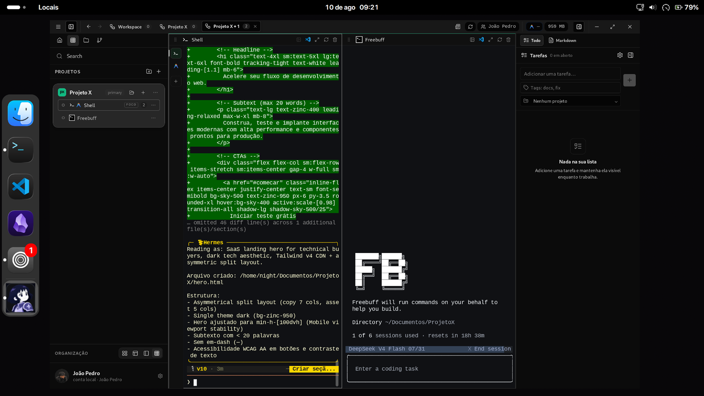

<a id="readme-top"></a>

<br />
<div align="center">
  <a href="https://github.com/Kc1t/alethe-agents-mac">
    
  </a>

  <h1 align="center">Alethe <sup>Mac Version</sup></h1>

  <p align="center">
    <b>The multi-agent coding workspace, native on macOS.</b>
    <br />
    Run Claude Code, Codex, Copilot and your shells side by side — in one local-first Mac app.
  </p>

  <p align="center">
    
    
    <a href="./LICENSE"></a>
    <a href="https://github.com/Kc1t/alethe-agents"></a>
  </p>

  <p align="center">
    <a href="#install">Install</a>
    ·
    <a href="#run-from-source">Build from source</a>
    ·
    <a href="https://github.com/Kc1t/alethe-agents">Windows &amp; Linux ↗</a>
    ·
    <a href="https://github.com/Kc1t/alethe-agents-mac/issues/new?labels=bug">Report Bug</a>
    ·
    <a href="https://github.com/Kc1t/alethe-agents-mac/issues/new?labels=enhancement">Request Feature</a>
    ·
    <a href="./SECURITY.md">Security</a>
    ·
    <a href="./docs/PRIVACY.md">Privacy</a>
    ·
    <a href="#contributing">Contribute</a>
  </p>
</div>

> [!NOTE]
> **This is the Mac version of Alethe** — a native app written in Swift and SwiftUI, with libghostty terminals.
> **Looking for Windows or Linux?** Those builds live in a separate repository:
> **[Kc1t/alethe-agents](https://github.com/Kc1t/alethe-agents)** · [Downloads](https://github.com/Kc1t/alethe-agents/releases).
> Both apps are the same product and share the same data model. This one follows the Windows/Linux app as its
> baseline, and everything it does differently on purpose is listed in
> [`AletheNative/DIVERGENCES.md`](AletheNative/DIVERGENCES.md).

> [!IMPORTANT]
> The Mac version is in active development and has **no public release yet**: build it from source (see
> [Run From Source](#run-from-source)). It is free, open source, and local-first, not local-only: network features such
> as provider usage and GitHub Gist Sync are optional or action-triggered, and the Mac app has no update checker yet.
> See the [privacy and data-flow guide](./docs/PRIVACY.md) (written for the shared product).

<div align="center">
  
  <br />
  <sub>Preview of the shared interface.</sub>
</div>

## What Alethe Is

One agent in one terminal is easy. Five agents across three repositories is the actual job — and
that is where terminal tabs stop working: sessions get lost, MCP servers drift out of sync between
agents, and nobody knows which agent is doing what, where.

**Alethe is a desktop workspace built for that.** Every agent runs in a real PTY inside a persistent
project layout, keeps its own session and history, and stays alive when you rearrange the UI. On top
of that, Alethe manages the things agents share: their CLIs, their MCP servers, their skills, and the
conversations you move between them.

This repository is the **Mac version**: a native macOS app built with Swift 6, SwiftUI, AppKit, and libghostty. The
**Windows and Linux version** — built with Tauri, Rust, React, and `xterm.js` — lives in its own repository,
[Kc1t/alethe-agents](https://github.com/Kc1t/alethe-agents). “Local-first” describes workspace persistence, not an internet-free guarantee; see
[`docs/PRIVACY.md`](./docs/PRIVACY.md) for network defaults, credentials, and retention.

## Platforms

Alethe is one product in two repositories. **macOS is this repository**; Windows and Linux are in
[Kc1t/alethe-agents](https://github.com/Kc1t/alethe-agents).

<table>
  <tr>
    <th width="33.33%">macOS · <i>this repository</i></th>
    <th width="33.33%">Windows · <a href="https://github.com/Kc1t/alethe-agents">other repository ↗</a></th>
    <th width="33.33%">Linux · <a href="https://github.com/Kc1t/alethe-agents">other repository ↗</a></th>
  </tr>
  <tr>
    <td align="center">
      
    </td>
    <td align="center">
      <a href="https://github.com/Kc1t/alethe-agents"></a>
    </td>
    <td align="center">
      <a href="https://github.com/Kc1t/alethe-agents"></a>
    </td>
  </tr>
  <tr>
    <td align="center">Native Mac app — you are here</td>
    <td align="center"><a href="https://github.com/Kc1t/alethe-agents/releases">Get Alethe for Windows ↗</a></td>
    <td align="center"><a href="https://github.com/Kc1t/alethe-agents/releases">Get Alethe for Linux ↗</a></td>
  </tr>
</table>

<sub>The screenshots show the shared interface; the Mac app is built to match it.</sub>

## Agents

| Agent | CLI | |
|---|---|---|
| **Claude Code** | `claude` | Session resume, usage cards, local history |
| **Codex** | `codex` | Session resume, usage cards |
| **GitHub Copilot CLI** | `copilot` | |
| **Cursor** | `cursor-agent` | Session resume |
| **Antigravity** | `agy` | Usage cards |
| **OpenCode** | `opencode` | Session resume |
| **Kiro CLI** | `kiro-cli` | |
| **Mimo** | `mimo` | |
| **Freebuff** | `freebuff` | |
| **Shell** | pwsh / bash / zsh | The plain terminal, same pane model |
| **WSL** | `wsl.exe` | Windows only — see [Kc1t/alethe-agents](https://github.com/Kc1t/alethe-agents) |

Missing CLIs can be installed, updated, and uninstalled from inside Alethe, using each vendor's own macOS
instructions (an install script, Homebrew, or npm). Already-installed CLIs are discovered on `PATH` and in the usual
npm-global, nvm, Volta, and mise locations, and can be pointed at a custom path in Settings. Custom agents can be
added in Settings too.

Agents can optionally be routed through [9router](https://github.com/decolua/9router), a local proxy
that spreads traffic across providers with automatic fallback. Alethe installs and runs a private,
version-pinned copy without touching your global npm packages. Routing is off by default and applies
only to terminals opened after it is switched on.

## What It Does

**Run agents in parallel**

- Projects, groups, and subgroups organize repositories; each open project becomes a container with
  its own panes.
- One agent per pane, or several agents as sub-tabs inside the same pane — each with its own PTY,
  working directory, and session.
- Auto, spotlight, sidebar, and custom grid layouts, editable directly on the grid.
- Closing a container hides it; the process keeps running.

**Keep the context**

- Sessions of Claude Code, Codex, Cursor, and OpenCode resume after a crash or a restart.
- **Recent chats** lists the conversations of a pane's working directory and reopens any of them.
- A Claude Code conversation can be **handed off to Codex** (and back) through a locally redacted
  context packet — no copy-pasting the thread by hand. Redaction is best effort, so review the packet
  before starting the target agent.
- Scrollback is persisted per PTY, so reattaching shows what happened before.

**Manage what the agents share**

- **MCP tab**: every MCP server configured on the machine, grouped by server and showing which agents
  have it — read from Claude Code, Codex, Cursor, OpenCode, and Antigravity configs. Add, remove,
  copy a server from one agent to another, search the official registry, and ask each agent to verify
  it can really reach a server. Every write is backed up, re-parsed, and committed atomically.
- **Skills tab**: the skills installed for each agent, with links and shared stores resolved so a
  shared skill shows up once.
- **Graphify**: a code graph of the project, served to the agents as an MCP server.

**Extend it with plugins**

- Features load as **plugins**, not hard-wired code. The official ones — Todo List, Git Control, Theme Pack — are
  built in and can be switched off in Settings, with their surfaces appearing and disappearing without a restart.
- Third-party plugins use Apple's ExtensionKit. The JavaScript plugin format of the Windows/Linux app is **not**
  supported on the Mac; how to build and publish those plugins is covered in the
  [Windows/Linux plugin guide](https://github.com/Kc1t/alethe-agents/blob/main/docs/PLUGINS.md).

**Stay in control**

- RAM readout in the title bar; disable a terminal or suspend a whole group to get memory back.
- Git panel per project — status, stage, commit, branches, diffs in a pane — plus worktrees for
  parallel tasks.
- **Pull Request review**: the merge panel finds the open GitHub PR for an agent worktree through the
  local `gh` CLI, opens its metadata, and can start an AI review inside the same isolated worktree —
  read-only, with no commits, pushes, merges, or GitHub comments. Squash-merging stays an explicit
  human action, blocked when the head SHA moved, the PR is a draft, or GitHub reports conflicts. No
  GitHub token is stored; authentication is delegated to `gh`.
- Content panes beside the terminals: file explorer, Markdown, diffs, images, video, embedded browser.
- Todos per project with a Pomodoro timer, isolated profiles, local backup export/import, UI and
  terminal themes, EN and pt-BR.
- **Orchestration board**: a lead agent delegates units of work to Claude and Codex workers that
  Alethe runs in parallel — each optionally in its own git worktree, each reporting status, cost,
  tokens and diff on its card, and each able to ask you before it leaves its sandbox. Off by default.
- **Voice dictation** with Apple's on-device speech recognition, and manual **GitHub Gist Sync** of your
  preferences — both optional. First-party cloud sync is not part of the Mac version.
- **Remote Control**: an authenticated LAN web view, paired by QR code, to follow and answer agents
  from your phone. It is off by default and uses unencrypted HTTP/WebSocket transport on the LAN, so
  enable it only on a trusted network. Clean profiles are read-only; answering agents requires a
  separate input opt-in, and shell input has its own additional opt-in.
- Spotify Now Playing, using your own Spotify app credentials in **Settings** with
  `http://127.0.0.1:8888/callback` as the redirect URI. The secrets are kept in the macOS Keychain.

## Core Concepts

| | |
|---|---|
| **Group** | A collection of projects that opens, collapses, and suspends together. |
| **Project** | A saved working context: terminals, layout, color, local state. |
| **Container** | The visible frame of an opened project. Closing it does not kill anything. |
| **Pane** | A terminal view inside a container. |
| **Sub-tab** | A separate agent or shell session inside the same pane. |
| **PTY** | The real backend process, alive independently of the UI. |

## Product Philosophy

A focused core with optional capabilities, closer to Obsidian than to a maximalist IDE. Non-essential
features ship behind feature flags or opt-in settings, and a clean installation stays a first-class
experience. Coherence over volume.

## Install

The Mac version has **no public release yet**: builds are not notarized, and the first public DMG is on the
[roadmap](#roadmap). For now, [build it from source](#run-from-source).

A build that is not notarized may be blocked by Gatekeeper, which can refuse to open the app or report it as damaged.
Move `Alethe.app` to `/Applications` and clear the quarantine flag:

```bash
xattr -dr com.apple.quarantine /Applications/Alethe.app
```

Prefix it with `sudo` if macOS asks for permission, and repeat it after installing each new version, since every fresh
download is quarantined again. Only do this for a build you made yourself or downloaded from this repository's
Releases page.

> [!NOTE]
> **Windows or Linux?** Those installers are published in
> [Kc1t/alethe-agents → Releases](https://github.com/Kc1t/alethe-agents/releases), together with the Windows Defender notes.

## Run From Source

Requirements: macOS 26 or later, Xcode 27 (Swift 6.4), [Zig](https://ziglang.org) 0.16, and Xcode's Metal Toolchain
(`xcodebuild -downloadComponent MetalToolchain`).

```sh
git clone https://github.com/Kc1t/alethe-agents-mac.git
cd alethe-agents-mac/AletheNative
Vendor/ghostty/build.sh   # builds libghostty into Vendor/GhosttyKit (once; about 40 MB, git-ignored)
Scripts/build.sh Debug    # → build/DerivedData/Build/Products/Debug/Alethe.app
open build/DerivedData/Build/Products/Debug/Alethe.app
```

```sh
Scripts/test.sh           # string-catalog gate, divergence registry, package tests, and a build
Scripts/make-dmg.sh       # a DMG (not notarized) → build/Alethe-macOS-universal.dmg
```

Building the Windows or Linux app from source is covered in
[Kc1t/alethe-agents](https://github.com/Kc1t/alethe-agents#run-from-source).

## Terminal Command

Install the `alethe` command from **Settings** (*Terminal command*):

```bash
alethe                # opens the current folder as a project
alethe ~/some/project # opens the given folder
```

If the folder is already a project, it is brought into the workspace instead of duplicated. If Alethe
is already running, the existing window is focused. The command lands in `~/.local/bin/alethe` — reinstall it
after moving the app.

## Roadmap

- [x] Native macOS app: libghostty terminals, projects, groups, containers, and sub-tabs.
- [x] Session resume, agent install/update, MCP and skills management, Git, PR review, orchestration board, and remote control.
- [ ] Full parity with the Windows/Linux interface — see the [parity matrix](docs/MAC_NATIVE_V2_PLAN.md) (§8).
- [ ] Triage of the Windows/Linux changes since the last reviewed baseline ([`AletheNative/upstream-reports/`](AletheNative/upstream-reports/)).
- [ ] Notarized public release (DMG) and in-app updates (Sparkle).

## Contributing

Contributions are welcome. Read [`CONTRIBUTING.md`](CONTRIBUTING.md) for setup, project layout, and
house rules. The easiest ways to help:

- Pick an [open issue](https://github.com/Kc1t/alethe-agents-mac/issues), report a bug with clear reproduction steps, or request a feature with the workflow it improves.
- Improve docs, add native screenshots (the ones above show the shared interface), and test on different Macs and macOS versions.
- Anything the Mac app does that the Windows/Linux app does not must be registered in
  [`AletheNative/DIVERGENCES.md`](AletheNative/DIVERGENCES.md) — see the rule in [`CLAUDE.md`](CLAUDE.md).
- Windows and Linux contributions belong in [Kc1t/alethe-agents](https://github.com/Kc1t/alethe-agents).

For larger changes, open an issue first so the direction can be discussed.

## Built with Alethe

Projects and products built with Alethe as the workspace — agents running in parallel, shells alongside them, sessions resumed across days.

<!-- showcase:start -->

_Nothing here yet._ Built something with Alethe? Add it to [`SHOWCASE.md`](SHOWCASE.md) — it's one line and a pull request, and you end up in the contributors list too.

<!-- showcase:end -->

See [`SHOWCASE.md`](SHOWCASE.md) for the full list and how to submit.

## Watch Alethe in Action

See Alethe in real development workflows and learn how to orchestrate coding agents in parallel.

<table>
  <tr>
    <th width="38%">Video</th>
    <th>What you will see</th>
  </tr>
  <tr>
    <td>
      <a href="https://www.youtube.com/watch?v=8jvrucR7QCU&amp;t=54s">
        
      </a>
    </td>
    <td>
      <strong><a href="https://www.youtube.com/watch?v=8jvrucR7QCU&amp;t=54s">Stop Using One AI Agent at a Time: Orchestrate AI Agents</a></strong>
      <br><br>
      A practical introduction to coordinating multiple AI coding agents instead of working with only one at a time.
      <br><br>
      <sub>Kauã Miguel - Dev · Portuguese</sub>
    </td>
  </tr>
  <tr>
    <td>
      <a href="https://www.youtube.com/watch?v=reUN7CkMbgM&amp;t=100s">
        
      </a>
    </td>
    <td>
      <strong><a href="https://www.youtube.com/watch?v=reUN7CkMbgM&amp;t=100s">A Day in the Life of a Software Developer — Devlog 1</a></strong>
      <br><br>
      A real-world developer workflow showing Alethe as part of the day-to-day coding process.
      <br><br>
      <sub>Guilherme Dev · Portuguese</sub>
    </td>
  </tr>
</table>

## Also On Mobile

https://github.com/user-attachments/assets/ae3aed75-2ead-43c4-a9ca-fd29d83b7e1d

## Contributors

Thanks to everyone helping shape Alethe. The native macOS app grew from the `mac-native-v2` branch started by
[HayatoG](https://github.com/HayatoG); the contributors below shaped the product it follows.

<p align="center">

  <!-- contributors:start -->
  <a href="https://github.com/Kc1t"></a>
  <a href="https://github.com/MiguelSilvaPorto"></a>
  <a href="https://github.com/HayatoG"></a>
  <a href="https://github.com/slegarraga"></a>
  <a href="https://github.com/lucapohl-angel"></a>
  <a href="https://github.com/1arley"></a>
  <a href="https://github.com/potatoiscompiled"></a>
  <a href="https://github.com/GustavoAlmeidaDoNascimento"></a>
  <a href="https://github.com/Jbnado"></a>
  <a href="https://github.com/chintanparmar011"></a>
  <a href="https://github.com/AshSgDe29071999"></a>
  <a href="https://github.com/sthevan027"></a>
  <a href="https://github.com/rlevidev"></a>
  <a href="https://github.com/mapsiva"></a>
  <a href="https://github.com/moisesz10"></a>
  <a href="https://github.com/Bakurin0"></a>
  <a href="https://github.com/SrAmaral"></a>
  <a href="https://github.com/diegoliveiraa"></a>
  <a href="https://github.com/VicktorMS"></a>
  <a href="https://github.com/rad4manthys"></a>
  <a href="https://github.com/lucianoschirmer"></a>
  <a href="https://github.com/lb1192176991-lab"></a>
  <a href="https://github.com/hgshreyas"></a>
  <a href="https://github.com/fernando-c-lima"></a>
  <a href="https://github.com/feejunior"></a>
  <a href="https://github.com/eudehh"></a>
  <a href="https://github.com/dudukings1"></a>
  <a href="https://github.com/davidwallaci"></a>
  <a href="https://github.com/tomatotomata"></a>
  <a href="https://github.com/ThiagoSales17"></a>
  <a href="https://github.com/opedrooz"></a>
  <a href="https://github.com/devmatheusmota"></a>
  <a href="https://github.com/JohnPss"></a>
  <a href="https://github.com/GabrielKLopes"></a>
  <a href="https://github.com/pinhaum"></a>
  <a href="https://github.com/floze-the-genius"></a>
  <a href="https://github.com/aryansk"></a>
  <a href="https://github.com/sousaakira"></a>
  <!-- contributors:end -->
</p>

## License

The source code is distributed under **AGPL-3.0-or-later**. Modifications and covered derivative
works that are distributed, or made available to users over a network, must provide their
corresponding source under the same license. See [`LICENSE`](LICENSE) and [`NOTICE`](NOTICE).

Official hosted services, such as sync, backup, billing, or cloud features, may be proprietary and
offered separately. The code license does not grant rights to the **Alethe** name, logo, application
icon, or official branding. Modified builds must be independently branded, and commercial use of
the Alethe brand requires prior written permission from Kauã Miguel. See
[`TRADEMARK.md`](TRADEMARK.md).

## Community

- Security reports: [`SECURITY.md`](SECURITY.md)
- Privacy and data flows: [`docs/PRIVACY.md`](docs/PRIVACY.md)
- Maintainer: [Kc1t](https://github.com/Kc1t)
- Mac version (this repository): <https://github.com/Kc1t/alethe-agents-mac>
- Windows and Linux version: <https://github.com/Kc1t/alethe-agents>
- Mac bugs and feature requests: <https://github.com/Kc1t/alethe-agents-mac/issues>
- Windows/Linux bugs and feature requests: <https://github.com/Kc1t/alethe-agents/issues>
