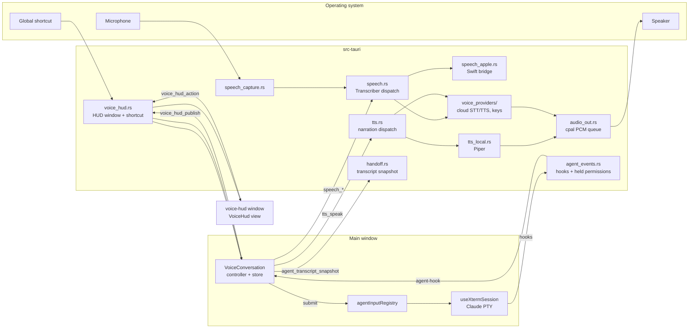

# Voice in Alethe — architecture and review guide

This document describes the voice work that landed together: **voice conversation with Claude Code
and the other agents Alethe runs**, the **floating HUD with a system-wide shortcut**, **Apple's
on-device speech recognition on the Mac**, and **per-use voice providers** (local models and cloud
APIs) with a dedicated **Preferences → Voice** page. It is written for whoever reviews or maintains
this code: what each part does, where it lives, how data flows, what was decided and why, and how it
was verified.

User-facing descriptions live in [`CHANGELOG.md`](CHANGELOG.md) (`[Unreleased]`) and
[`FEATURES.md`](FEATURES.md) (Speech models, Voice Conversation, Voice providers). The design
records, with the reasoning behind each decision, are in `docs/superpowers/specs/`:

| Spec | Plan |
|---|---|
| [`2026-10-14-voice-conversation-design.md`](superpowers/specs/2026-10-14-voice-conversation-design.md) | [`plans/2026-10-14-voice-conversation.md`](superpowers/plans/2026-10-14-voice-conversation.md) |
| [`2026-10-14-voice-hud-design.md`](superpowers/specs/2026-10-14-voice-hud-design.md) | [`plans/2026-10-14-voice-hud.md`](superpowers/plans/2026-10-14-voice-hud.md) |
| [`2026-10-14-macos-native-stt-design.md`](superpowers/specs/2026-10-14-macos-native-stt-design.md) | [`plans/2026-10-14-macos-native-stt.md`](superpowers/plans/2026-10-14-macos-native-stt.md) |
| [`2026-10-15-voice-providers-design.md`](superpowers/specs/2026-10-15-voice-providers-design.md) | [`plans/2026-10-15-voice-providers.md`](superpowers/plans/2026-10-15-voice-providers.md) |

Where this document and a spec disagree, this document describes the code as shipped. Known
differences are listed in [§11](#11-differences-from-the-specs).

---

## 1. What shipped

| Feature | In one sentence |
|---|---|
| Voice conversation | Hold a shortcut, speak, and the transcript goes to the active Claude pane; Alethe narrates what Claude does and lets you answer its permission requests by voice or with a click. |
| HUD + global shortcut | The shortcut works from any app; while Alethe is in the background a floating, non-activating HUD shows the conversation. |
| Apple native STT | On macOS 12+, *Apple (native)* is a speech-to-text engine next to Parakeet and Zipformer: no download, on device only, one language at a time. |
| Voice providers | Dictation, conversation and narration each pick a provider: local models (Parakeet, Zipformer, Whisper, Moonshine, Piper, Apple Speech, system voice) or a cloud API with the user's own key (OpenAI, ElevenLabs, Gemini, OpenRouter), with a local fallback when the cloud fails. |
| Model downloads | Speech model downloads show bytes, file, speed and ETA, report the SHA-256 check, resume a `.part` file, and throttle progress events. They can be paused, resumed and cancelled (`speech_pause_download`, `speech_cancel_download`). |

Supporting changes that ride along:

- `Dropdown` keeps its search box usable inside modal dialogs (Radix `FocusScope`), needed by the
  searchable model pickers in Preferences.
- Portuguese comments and log messages in `Cargo.toml`, `lib.rs` and `AgentCanvasPOC` were
  translated to English (repository language rule).
- The detached orchestration window's read-only `projects.json` reload moved into
  `useReadOnlyProjectsHydration`, now shared with the HUD window.

---

## 2. Big picture

The **controller runs in the main window**, where the stores and PTY ids live. The HUD is a thin
view: it renders the state the main window publishes and sends user actions back. It never writes
to a PTY and never answers a permission by itself.

---

## 3. Voice conversation

### 3.1 Flow of one turn

1. **Speak.** The shortcut (`voiceShortcut`, default `CmdOrCtrl+Shift+Space`) starts capture.
   Push-to-talk: hold it. Toggle: press, then press again. Narration pauses at once (barge-in);
   it is dropped only when a transcript is sent. A press that sends nothing (a stray tap, silence,
   a failed transcription or engine) leaves it paused, to resume with the pause button.
2. **Transcribe.** `speech_stop_and_transcribe` with the provider chosen for the *Conversation*
   use. An empty transcript ends the turn.
3. **Route** (`src/lib/voice/routing.ts`), on the normalised first word(s):
   - the Jev trigger (`voiceJevTrigger`, default `alethe`, matched with STT spelling variants and
     edit distance 1) or the shortcut with `Alt` → the text goes to the Jev command bar
     (`uiStore.openVoiceCommand`);
   - an interrupt word (`voiceInterruptWords`, default `stop`, `espera`, `cancela`) followed by
     punctuation or the end → `Esc` to Claude first, then the rest is sent;
   - otherwise → sent to the target pane.
4. **Send.** Target = the active Claude pane, else the last focused one (`lib/voice/target.ts`),
   switchable from the panel. Sending goes through `agentInputRegistry`, never raw PTY writes (§3.2).
5. **Narrate** (`lib/voice/narrator.ts`) from hook events and the session transcript (§3.3).
6. **Approve** permission requests by voice or click (§3.4).

State machine (`lib/voice/stateMachine.ts`):
`idle → listening → transcribing → sending → working → idle`, with `awaiting-permission` reachable
from `working`, and `listening` reachable from `working` (talking mid-task: queue by default,
`voiceMidTaskDefault: 'interrupt'` sends `Esc` first).

### 3.2 Writing into Claude safely — `agentInputRegistry`

`useXtermSession` registers, per Claude PTY, a `submit(text)` and an `interrupt()`:

- `submit` uses the shared `pasteAndSubmit` helper (`lib/agentPromptDelivery.ts`): bracketed paste
  through `writePtyChunked`, 150 ms, one `\r`. The initial-prompt path uses the same helper and
  keeps its extra `\r` retries; **the voice path sends none**, because a stray Enter landing on a
  permission menu that opens a moment later would approve a tool call nobody approved.
- Before the paste **and again right before the Enter**, the live screen is checked
  (`readLiveScreen` + `looksLikeChoicePrompt`). If Claude's own numbered menu is showing, the send is
  refused with `TerminalPromptOpenError`; a hidden pane (no output to check) refuses with
  `PaneHiddenError`. `Esc` is not guarded: on that menu it cancels, never approves.
- The completion monitor is armed (`AgentCompletionMonitor.armForSubmit`) only once the Enter is
  certain, so a refused submit leaves the pane idle.
- Entries are removed on exit, suspend and dispose.

### 3.3 Narration

- **Sources:** `agent-hook` events for the target PTY, and assistant text read with the new
  `agent_transcript_snapshot` command (`handoff.rs`), polled by revision while working. The
  snapshot now reports `firstIndex`, the absolute index of its first event, so the narrator counts
  events by position even after the head of a long transcript is dropped.
- **Text cleanup:** markdown is stripped; code blocks, tables, links and long lists become short
  phrases ("a code block", "and 3 more").
- **Fill:** after `voiceFillAfterMs` (default 8 s, 3–60 s) of silence while a tool runs, a templated
  status is spoken from the latest `PreToolUse` ("Running the tests.", "Editing auth.ts.").
- **Verbosity:** `silent` (none of Claude's text), `final` (final answer only), `normal` (text as it
  works + fills), `detailed` (also each tool start). Permission questions are spoken at every
  verbosity unless the approval channel is *Panel only*.
- `Stop` speaks `last_assistant_message`, skipped if the transcript poll already queued it.

### 3.4 Permissions held for a voice answer — `agent_events.rs`

- `agent_hooks_settings_path(..., voice)` adds `PreToolUse`, `PostToolUse`, `Stop` and
  `PermissionRequest` to the per-terminal hooks file. Events present only because of voice carry
  `X-Alethe-Voice-Only: 1`; their payloads are tagged `voiceOnly: true`, and the orchestrator
  canvas, the agent sandbox and `AgentCanvasPOC` ignore them. Hooks are written at launch, so the
  feature applies to Claude panes opened after it is turned on.
- `PermissionRequest` has its own entry with a 300 s timeout. The listener is serial, so the request
  is **handed off** to a pending map keyed by a request id and the loop continues; the payload goes
  to the frontend with `permissionRequestId`.
- Holding is selective: only PTYs passed to `voice_set_targets` are held; any other request gets
  an empty 200 immediately (Claude shows its normal prompt). Only PTYs launched with the voice
  hooks can be targets (`agent_voice_hooked_ptys`).
- A Claude that is running without the hooks (launched while voice was off) is not a target, but it
  is not hidden either: `voiceRestartable` lists it in the picker, disabled, with "Restart this
  Claude to use voice" and a **Restart** entry under it. The HUD sends
  `{kind:'restart-session', ptyId}`; the main window runs `restartVoiceSession`
  (`src/lib/voice/restartSessions.ts`), which relaunches the tab through `restartAgentTab`
  (`src/lib/agentTabRestart.ts`, the same path as the pane's restart button: same PTY id, resuming
  its conversation id) and refreshes the hooked list, so the session becomes selectable. It asks
  Rust for the hooked list first and does nothing unless the session is still running, still
  without the hooks and not in a disabled pane, since the picker it came from may be stale. Turning
  voice on in Preferences (`offerVoiceRestart`) toasts how many running sessions need a restart
  (`restartNeededOne` for one), with **Restart now**, which reads the list again when clicked.
  Resolution (`resolveTarget`) only ever sees hooked sessions.
- `agent_permission_decide(requestId, allow | deny | defer, message?)` answers a held request;
  unknown or already-answered ids are rejected. A spoken "no, use pnpm" becomes a deny with that
  message, which Claude reads as an instruction.
- Rust releases a held request on its own with an empty 200 after **290 s** (before the 300 s hook
  timeout, whose behaviour is undocumented), when the PTY leaves the targets, and on app exit
  (`release_all_permissions` on `ExitRequested`). Each release emits
  `agent-permission://released {requestId, reason}` so the card goes away.
- `agent_permission_decide` and `voice_set_targets` reject any caller window other than `main`.
- Logging of `PreToolUse`, `PostToolUse` and `PermissionRequest` keeps only the event and tool
  names: their payloads carry commands and file contents.

**Destructive commands** (`lib/voice/permissions.ts`: `rm -rf`, `git push --force`,
`git reset --hard`, SQL `DROP`, writes outside the project, …) need a click by default
(`voiceDestructiveNeedsHud`); a spoken "yes" is not enough, since a misheard word would run them.
Spoken answers are parsed in English and Portuguese.

### 3.5 The panel

`VoiceConversation` (container) + `VoiceConversationView` (pure view, also used by the HUD):
waveform (`VoiceSpectrum`, extracted from the Jev bar), phase, transcript, narration text,
permission card (Allow / Deny / Answer in the terminal), target picker, notices, stop-speaking and
narration speed (1x–2x).

---

## 4. Floating HUD and system-wide shortcut — `voice_hud.rs`

- **Window.** Label `voice-hud`, created hidden once at startup, 560 × 240 logical px, no
  decorations, always on top, `focusable(false)`, on all workspaces. On macOS it becomes a
  **non-activating `NSPanel`** through `tauri-nspanel` (floating level, `canJoinAllSpaces |
  fullScreenAuxiliary`), so clicking Allow keeps the other app focused and the HUD shows over
  full-screen apps. This requires `app.macOSPrivateApi: true` and Tauri's `macos-private-api`
  feature (acceptable: Alethe is not distributed through the Mac App Store).
- **Which surface shows** (`lib/voice/surface.ts`, pure): Alethe focused → in-window panel;
  otherwise the HUD while the turn is active and for 4 s after it; the close button hides the HUD
  until the next press.
- **Position.** Six presets on the monitor under the pointer, inside its work area, or `custom`
  after a drag: stored as fractions of the monitor work area plus the monitor's physical bounds (to
  tell identical monitors apart). A missing monitor falls back to bottom-center; the saved spot is
  kept. Placement maths is pure and unit-tested.
- **Relay.** `voice_hud_publish` (main → HUD, throttled to 100 ms), `voice_hud_snapshot` (HUD
  reload), `voice_hud_action` (HUD → main), `voice_hud_moved` (drag end). Each command checks the
  caller's window label.
- **Shortcut.** `tauri-plugin-global-shortcut` (`~2.3`; 2.4 needs Tauri 2.12 / rustc 1.90).
  `voice_shortcut_set` registers the accelerator and its `Alt` variant (Jev). While registered,
  the in-window listener is off; if registration fails, a toast explains and the in-window
  listener stays as a fallback.
- **Recorder** (`ShortcutRecorder`): press the combination; Esc cancels; it needs ⌘ or Ctrl
  (Shift alone only with F1–F24); Alt is reserved for Jev; a combination the OS or another app owns
  is refused because registration is tried **before** saving. While recording,
  `isRecordingShortcut()` pauses Alethe's own shortcuts (`useKeybindings`, dictation, the Jev bar,
  the todos composer).
- **Background.** The main window has `backgroundThrottling: "disabled"`, so narration timers and
  polls keep running while only the HUD is visible.
- **HUD window boot.** `main.tsx` renders `VoiceHud` for the `voice-hud` label in read-only mode
  (`setProjectsReadOnly(true)`): it never runs the app shell, never writes `projects.json`, never
  touches PTYs.
- **Exit.** Destroying the main window now exits the app (`exits_with_window`), because the hidden
  HUD would otherwise keep the process alive.

---

## 5. Speech-to-text engines

All engines sit behind one `Transcriber` trait in `speech.rs`; `transcriber_for` /
`engine_for` pick one from the provider and model id.

| Engine | Where | Notes |
|---|---|---|
| sherpa-onnx transducers | `speech.rs` | Parakeet TDT v3 (multilingual, ~670 MB), Zipformer GigaSpeech / small (English). |
| sherpa-onnx Whisper | `speech.rs` | Whisper base / small (multilingual, language detected per utterance). Audio longer than 28 s is cut into windows at the quietest 200 ms of each window's last 3 s, because Whisper drops audio past 30 s. |
| sherpa-onnx Moonshine | `speech.rs` | Moonshine base (English). |
| Apple (native) | `speech_apple.rs` + `swift/AletheSpeech` | macOS 12+. `SpeechAnalyzer` on macOS 26 (installable languages, progress reported through the download event), `SFSpeechRecognizer` with `requiresOnDeviceRecognition` on 12–15. Never Apple's servers. Silence that the older API reports as an error is normalised to an empty transcript. |
| Cloud | `voice_providers/stt_cloud.rs` | OpenAI / ElevenLabs (multipart WAV), Gemini (`generateContent` with inline audio), OpenRouter (`/audio/transcriptions`). 30 s timeout. |

**Swift bridge build** (`build.rs` → `link_apple_speech`): runs `swift build` on the package for
the target triple, links `libAletheSpeech.a`, the Swift runtime search paths and the `Speech` /
`AVFoundation` frameworks, and sets `cfg(apple_speech_linked)`. Without a Swift toolchain a debug
build continues without the engine (warning); **a release build fails**, so a Mac release never
ships without it by accident. The release workflow selects Xcode 26 and warns when Swift < 6.2
(then only the `SFSpeechRecognizer` path is compiled).

**Mac default.** `useSpeechEngineDefault` moves a Mac profile to Apple (native) **once**
(`speechEngineMigrated`), only when the stored choice is still the untouched Parakeet default and
Parakeet is not downloaded. A deliberate choice is never changed.

`src-tauri/Info.plist` declares `NSMicrophoneUsageDescription` and
`NSSpeechRecognitionUsageDescription` (asserted by `src/bundleInfoPlist.test.ts`);
`bundle.macOS.minimumSystemVersion` is `10.15`.

---

## 6. Narration engines (text-to-speech)

`tts.rs` keeps the command names `tts_speak`, `tts_stop`, `tts_voices` and dispatches on
`TtsProvider`:

| Provider | Implementation |
|---|---|
| `system` | The `tts` crate: AVSpeechSynthesizer (macOS), WinRT (Windows), speech-dispatcher (Linux, needs `libspeechd-dev` at build time). Its handle is not thread-safe, so the engine lives on the main thread and every command hops there. |
| `local` | Piper voices through sherpa-onnx (`tts_local.rs`): "Faber (pt-BR)" and "Amy (en-US)", downloaded as `.tar.bz2` archives with their `espeak-ng-data`. The last loaded voice stays cached (~60 MB). |
| cloud | `voice_providers/tts_cloud.rs`: PCM requested from OpenAI, ElevenLabs and Gemini; OpenRouter returns MP3, decoded with `symphonia`. Long text is split by sentence. |

Local and cloud audio play through **one `cpal` output stream** (`audio_out.rs`): a PCM queue on
its own thread (`cpal::Stream` is `!Send`); `stop()` clears the queue at once so barge-in still
works. Rate uses the provider's speed parameter where it exists, otherwise playback-rate
resampling.

**Test voice** in the Narration tab speaks a short localized sentence through the selected
provider and voice.

---

## 7. Voice providers and the Voice page

### 7.1 Backend — `src-tauri/src/voice_providers/`

| File | Responsibility |
|---|---|
| `mod.rs` | `CloudProvider` enum (`openai`, `elevenlabs`, `gemini`, `openrouter`). |
| `catalog.rs` | Curated STT/TTS models and voices per provider; `voice_provider_catalog`. |
| `keys.rs` | `voice_provider_set_key`, `voice_provider_delete_key`, `voice_provider_test`; `read_key_async` for cloud speech and narration; `delete_profile_keys` on profile deletion. **No command returns a key.** |
| `http.rs` | Request model behind an injectable transport, auth headers, error classification (`Auth`, `Quota`, `Network`, `Timeout`, `BadAudio`, `Other`), `safe_path_id` for ids placed in URLs. |
| `stt_cloud.rs` / `tts_cloud.rs` | Request building and response parsing per provider. |
| `openrouter.rs` | Live catalog (`voice_openrouter_models`), filtered to speech models with each model's voices, cached in memory. The list is public, so it shows before a key is saved (locked until one is). |

Keys are stored in the OS keychain per profile (`SecretKind::VoiceProviderKey`, accounts
`profile:<id>:voice-key-<provider>`). All cloud traffic is built and sent from Rust: the webview
never sees a key, and the CSP gains no `connect-src` entry.

On macOS a keychain read can show a password prompt that blocks its thread until answered (dev
builds are ad-hoc signed, so it returns after every rebuild). So:

- Every keychain read and write for a voice key runs on tokio's blocking pool
  (`keys::blocking` / `read_key_async`), never on an async worker that unrelated commands need.
- A key is read only when a cloud voice is actually used (prepare, transcribe, speak, ElevenLabs
  voices, **Test**), and at most once per run: `KeyCache` remembers the answer (key or no key) per
  profile and provider, saving or removing a key updates it, and a keychain error is not remembered
  so the next use asks again. Concurrent uses of one key wait for its one read; other keys stay
  readable meanwhile (one lock per key). Deleting a profile runs on the blocking pool too.
- Nothing reads keys at launch. `preferences.voiceProviders` (set by the key form on save, test and
  remove) is the source of truth for "configured". When `speech_prepare` answers `false` for a cloud
  provider (flags restored on a machine without the key), the dictation button, the Jev bar and the
  conversation controller call `forgetProviderKey`, which does what **Remove** does; an error from
  the check changes nothing. Narration that finds no key falls back like any other auth failure.
- The OpenRouter model list is public and is fetched without a key.

### 7.2 Fallback

If a cloud STT call fails (including a missing or unreadable key), `speech_stop_and_transcribe`
retries once locally — Apple Speech when it is ready for a chosen locale, else the first downloaded
sherpa model — and emits `voice://fallback {usage, provider, reason, fallback}`;
`useVoiceFallbackToasts` turns it into a toast naming the provider and the reason. Narration falls
back to the system voice. **A local failure never falls back to the cloud.** Only the provider id,
error class and HTTP status reach `spawn.log`.

### 7.3 Frontend

- **Preferences → Voice** (`components/modals/preferences/voice/`): `VoicePage` with usage tabs
  (Dictation · Conversation · Narration), opening with an **In use** summary and warnings
  (`inUseWarnings.ts`). Each tab shows the provider cards (local and cloud
  groups), the card in use marked **In use**, models picked from a searchable list
  (`ModelDropdown`); below them the tab's behaviour settings (the former Integrations sections). A
  **Accounts and models** grid with an All / Local / Cloud filter opens a provider page: key form
  (save, test, remove), privacy note and models. Models render in `ModelTable` (languages, speed and
  accuracy tiers via `TierDots`, size, status, "Used in", "Selected for", expandable details with
  "Use for …"): `LocalModelsView` for local models (download, pause, resume, cancel, remove; removing
  an in-use model resets that use to its default) and `CloudModelsView` for cloud ones (voices by
  language; OpenRouter's raw prices with a unit hint). `BuiltInProviderView` covers Apple Speech
  (languages, permission) and the system voice (voices per language with Test). **Compare models**
  on a use tab opens the table for that use. Speed/accuracy tiers are curated catalog data from
  published benchmarks; size, languages, status and prices are real data, and missing values show
  "—".
- **Narration voices** are grouped by language (`lib/voice/voiceLanguages.ts`): app language first,
  then multilingual voices, then the rest. Picking a model whose voices exclude the current voice
  selects one in the app language.
- `lib/speech/engine.ts` → `sttChoiceFor(prefs, 'dictation' | 'conversation')` is the single source
  for every speech consumer (dictation button, Jev bar, voice controller). The Jev bar uses the
  conversation choice.
- `preferences.voiceProviders` (flags only) is written by the key form when a key is saved, tested or
  removed; nothing reads the keychain at startup to rebuild it.
- The provider grid and the local models table show **Retry** when the model catalog or states
  cannot be read, instead of loading forever.

### 7.4 Model downloads (`speech.rs` + `ModelDownloadProgress`)

- Progress events are throttled to one per 200 ms (a 650 MB model used to emit tens of thousands).
- Each event carries `phase` (`downloading` / `verifying`), `file`, `fileIndex`, `fileCount`; the
  UI shows megabytes, current file, speed and time left (`lib/speech/downloadStats.ts`), and says
  when it is verifying the SHA-256 instead of sitting at 100%.
- An interrupted download keeps its `.part` file and continues with an HTTP `Range` request; a
  server that ignores the range restarts the file.
- **Pause / cancel** (`speech_pause_download`, `speech_cancel_download`): pause stops the transfer and
  keeps the partial files; it is persistent because the paused state is derived from the partial
  files on disk, not held in memory, and nothing resumes by itself. Resume continues from the
  `.part` file. Only one download runs at a time. Cancel deletes the whole partial model. A 30 s read
  timeout aborts a stalled transfer, leaving it resumable.
- Piper archives unpack into a staging folder, are checked for unsafe paths (anything that would
  leave the destination fails the whole archive; links are skipped) and are moved into place only
  when complete.

### 7.5 Hugging Face models

Local voices and recognizers beyond the built-in catalog can be searched on Hugging Face and
downloaded. All network access is in Rust.

**Layout.** `src-tauri/src/speech_hub/`: `hf.rs` (API client, host and redirect rules), `detect.rs`
(family detector, a pure function over the repo name and file list), `meta.rs` (languages, tiers,
voices), `search.rs` (search and resolve), `installed.rs` (manifests on disk), `mod.rs`
(commands). `speech_layout.rs` holds the recognizer layouts and `TtsLayout` (in `tts_local.rs`)
the voice layouts; both carry the file names, because files keep their repo names on disk.
Commands: `speech_hub_search` (list candidates) and `speech_hub_resolve` (pin the commit, list and
check the files). Downloads reuse `speech_download_model` with an `hf:` id.

**Search.** One API page per author and term, ranked and paged by the backend. Resolving a repo costs
2–3 API calls, so the frontend resolves only the first 10 results of each fetched page right away,
through one shared queue (at most 2 at once, each repo once); any other result is resolved when its
details are expanded, or by the download itself. Until then its size reads "—".

**Families.** A repo is offered only when its **repo name pattern and its required files both
match**. A repo name containing `streaming`, `online`, `apk`, `wheel`, `tagging`, `diariz`,
`denois`, `punct`, `speaker`, `kws`, `keyword`, `vad`, `spleeter`, `matcha` or `canary` is excluded,
as is one with the word `test` or `tests` (split on `-`, `_` and `.`, so `latest` stays) and a CTC
model that is not NeMo. An int8 variant is preferred when both exist; test wavs, READMEs, licenses
and scripts are never downloaded.

| Family | Use | Repo name | Required files |
|---|---|---|---|
| Piper / VITS | TTS | `vits-piper-*`, `vits-*` | `*.onnx`, `tokens.txt`, `espeak-ng-data/` or `lexicon.txt` |
| Kokoro | TTS | `kokoro-*` | `model*.onnx`, `voices.bin`, `tokens.txt`, `espeak-ng-data/` |
| Kitten | TTS | `kitten-*` | `model*.onnx`, `voices.bin`, `tokens.txt`, `espeak-ng-data/` |
| NeMo transducer | STT | `*parakeet*`, `*nemo*` (not CTC) | `encoder*`, `decoder*`, `joiner*`, `tokens.txt` |
| Transducer | STT | `*zipformer*`, `*conformer*`, `*transducer*` (not CTC) | `encoder*`, `decoder*`, `joiner*`, `tokens.txt` |
| Whisper | STT | `*whisper-*` | `*-encoder`, `*-decoder`, `*-tokens.txt` |
| Moonshine | STT | `*moonshine*` | `preprocess`, `encode*`, `uncached_decode*`, `cached_decode*`, `tokens.txt` |
| SenseVoice | STT | `*sense-voice*` | `model(.int8).onnx`, `tokens.txt` |
| Paraformer | STT | `*paraformer*` | `model(.int8).onnx`, `tokens.txt` |
| NeMo CTC | STT | `*ctc*` with `nemo` or `parakeet` | `model(.int8).onnx`, `tokens.txt` |
| Dolphin | STT | `*dolphin*` | `model(.int8).onnx`, `tokens.txt` |

**Security.**

- Only repos from an author allowlist fixed in code (`csukuangfj`, `csukuangfj2`, `k2-fsa`); public,
  non-gated repos, no token.
- Requests go only to `huggingface.co`; redirects are followed only to `huggingface.co`,
  `*.huggingface.co`, `hf.co` and `*.hf.co` over HTTPS, at most 5 hops.
- Repo names are `[A-Za-z0-9._-]`, at most 96 characters, never `..`, under an allowlisted author.
  Every file path goes through `safe_path`: at most 8 `/`-separated segments of `[A-Za-z0-9._+!-]`,
  never `.` or `..`, no segment ending in `.`, and no Windows reserved name (`con`, `prn`, `aux`,
  `nul`, `com1`–`com9`, `lpt1`–`lpt9`, with or without an extension), so it stays inside the model
  folder on every OS.
- The commit is pinned at resolve; every file is fetched from that commit.
- LFS files are verified by SHA-256; non-LFS files by git blob SHA-1 and capped at 16 MiB each.
  Models over 4 GiB are not offered; sizes are summed with saturation.
- Manifests are re-validated on every read (known family, safe paths, files present); an invalid
  manifest hides the model.

**Manifest.** `speech-models/hf--{author}--{repo}/alethe-model.json` records `version`, `id`,
`repo`, `commit`, `family`, `layout`, `files` (path, size, and `sha256` or `gitSha1`), `meta`
(label, languages, tiers, named voices), `stats` (likes, license, last modified) and `complete`. It
is written with `complete: false` when a download starts and flipped to `true` at the end. State stays derived from
disk, as for catalog models: a manifest that is not complete reads as paused ("Paused · X of Y
MB") after a restart, and nothing resumes by itself.

**Failures.** A file that answers 404 (the pinned commit is gone) deletes the model folder, forgets
the cached resolve and reports "This model is no longer available"; a 429 reports the rate limit.
A Hugging Face model that is not ready (a pending manifest, a failed download) can be removed from
its row. A downloaded recognizer that sherpa cannot load fails with "This model cannot run in
Alethe. Remove it in Preferences → Voice."; a voice that cannot load falls back to the system voice
and logs `voice tts: local hub model failed to load` to `spawn.log`. The table does not mark such a
model in advance: it reads Ready until used.

**Voices.** Named speakers come from the manifest without loading the model; only a model whose
speakers are not named is loaded, to count them. The speaker picker shows only for the model that
narrates. For Kokoro, the speaker's language sets the engine's `lang` (`en-us`, `en-gb`, `es`,
`fr-fr`, `hi`, `it`, `pt-br`; Kokoro's default for Chinese, Japanese and anything else).

**Reviewing.** Rust: the tests under `speech_hub` (detector against real API JSON fixtures in
`speech_hub/testdata/`, file selection, manifests, redirect host check, layouts, tiers/languages).
Frontend: `src/lib/voice/hubModels.test.ts`,
`src/components/modals/preferences/voice/useHubSearch.test.ts` and `LocalModelsView.test.tsx`.

### Local voice servers

Narration can speak through a text-to-speech server the person runs, on this computer or the local
network. The PyTorch-based voice models stay outside the app: Alethe only sends text and plays the
audio back, so there is nothing heavy to bundle. Code: `src-tauri/src/voice_servers/` (`error.rs`,
`netpolicy.rs`, `id.rs`, `adapter.rs`, `store.rs`, `client.rs`, `commands.rs`).

**Kinds and endpoints.**

| | OpenAI-compatible | Fish Speech |
|---|---|---|
| Speech | `POST {base}/v1/audio/speech` `{ model, input, voice, response_format: "mp3", speed }` | `POST {base}/v1/tts` `{ text, reference_id, format: "mp3", normalize: true }` |
| Model | saved `model`, else `"tts-1"` | none |
| Speed | sent as `speed`, played at 1.0 (some servers ignore it) | not sent, applied at playback |
| Health | `GET /v1/audio/voices`, then `/voices`, then `/v1/models` | `GET /v1/health` |
| Voices | `GET /v1/audio/voices`, then `/voices` | `GET /v1/references/list` |
| Auth | `Authorization: Bearer {key}` when a key is saved | same |

Voice lists are parsed tolerantly (array of strings, `{ voices }`, objects with `id` / `name` /
`voice_id`, Fish's `reference_ids`); duplicates are dropped, at most 500 voices of 128 characters.
Anything else reads as an empty list and the voice field is free text. Audio replies are MP3 or WAV,
capped at 50 MB.

**Storage.** The list is per profile at `{profile}/voice-servers.json` (version 1, at most 32
servers, names up to 64 characters, written atomically). Ids are `nanoid`s. The optional API key
lives in the OS keychain under the account `voice-server-{id}`; the JSON only keeps a `hasKey`
flag. Deleting a server deletes its key. A corrupt or unknown-version file reads as an empty list
and is not overwritten until the next save.

**Network policy** (`netpolicy.rs`). A base URL must be `http` or `https` with a host and no
userinfo, query or fragment. Every address the host resolves to must be loopback, private
(`10/8`, `172.16/12`, `192.168/16`) or link-local/unique-local IPv6 (`fe80::/10`, `fc00::/7`);
public, `169.254.0.0/16`, unspecified and multicast addresses are refused, and a host with any
refused address is refused whole. The check runs when saving and before every request (DNS lookup
limited to 5 s); each request pins the connection to the checked address, ignores system proxies
and never follows redirects. Probe replies are capped at 1 MB. The UI warns when the resolved
address is not loopback, since text then crosses the network, unencrypted over `http`.

**Narration flow.** `tts_speak` with `provider: "server"` looks the server up by id, then speaks in
400-character chunks (120 s timeout per chunk) through the shared player. The voice is chosen in the
Narration panel, from `tts_voices` with `provider: "server"` (there is no separate voices command).
When the server is missing, or fails before any audio played, the whole text goes to the system voice
under the same utterance id and `voice://fallback` is emitted with `provider: "server"`, the server
id and a reason; the UI shows a "Local server" toast. A failure mid-utterance stops where it is.
Errors surface as `voice_server_{kind}` (`policy`, `network`, `timeout`, `auth`, `badRequest`,
`badAudio`, `missing`, `other`); logs and events carry only the id and kind, never the URL, key,
response body or narrated text.

**Reviewing.** `cd src-tauri && cargo test voice_servers::` covers the policy (including DNS pins
and refused ranges), adapters and voice parsing, the store, the client against a local test server
and the narration routing. Frontend: the `ServerDetail`, `ServerGroup` and Narration panel server
card tests. Check that no key, URL or text reaches logs or events, that redirects and proxies stay
off, and that the cloud client is still `https_only`.

---

## 8. Preferences and migration

All fields live in `Preferences` (`src/lib/types.ts`), are normalised in
`normalizePreferences` (`src/stores/projectsStore.migrations.ts`) and keep the `projects.json`
file version unchanged (backfill, as earlier preference additions).

| Field | Default | Synced |
|---|---|---|
| `voiceConversationEnabled` | `false` | yes |
| `voiceShortcut` | `CmdOrCtrl+Shift+Space` | yes |
| `voiceCaptureMode` | `push-to-talk` (`toggle`) | yes |
| `voiceVerbosity` | `normal` | yes |
| `voiceFillAfterMs` | `8000` (clamped 3000–60000) | yes |
| `voiceApprovalChannel` | `both` (`voice`, `hud`) | yes |
| `voiceDestructiveNeedsHud` | `true` | yes |
| `voiceMidTaskDefault` | `queue` (`interrupt`) | yes |
| `voiceInterruptWords` | `['stop', 'espera', 'cancela']` (trimmed, lower-cased, max 10; an explicit empty list is kept) | yes |
| `voiceJevTrigger` | `alethe` | yes |
| `voiceHudPosition` | `bottom-center` (`custom` only when a custom position exists) | no |
| `voiceHudCustomPosition` | `null` (`{ monitor, x, y, bounds? }`, fractions clamped to 0–1) | no |
| `voiceStt` | `{ dictation, conversation }`, both local Parakeet | no |
| `voiceTts` | `{ provider: 'system', model: '', voice: null, rate: 1 }` | no |
| `voiceProviders` | `{}` — flags only, never a key | no |
| `voiceTts.server` | `null` (id of the local voice server used when `provider` is `server`) | no |
| `speechEngineMigrated` | `false` | no |

**Legacy fields** `dictationModelId`, `dictationNativeLocale`, `voiceTtsVoice` and `voiceTtsRate`
are folded into `voiceStt` / `voiceTts` (`lib/voice/voicePreferences.ts`) and then removed. An
unknown provider, or a cloud provider without a configured key, resets that use to its local
default.

The local voice server list is not a preference: it lives per profile in `voice-servers.json`
(see Local voice servers).

---

## 9. Security and privacy

- **Local by default.** Audio or text leaves the device only for a use the person set to a cloud
  provider, or, for narration, to a local voice server they configured (text goes over HTTP to that
  address on this computer or the LAN); provider cards say "Audio is sent to …" / "Narration text
  is sent to …".
- **Keys** live in the OS keychain, are written and tested from Rust, and are never returned to the
  webview or logged.
- **Local servers are LAN-only.** Local voice server URLs must resolve to loopback or private
  addresses, checked at save and per request with the connection pinned; no redirects, no proxy.
  Their keys are in the keychain like cloud keys.
- **CSP unchanged** (`src/securityPolicy.test.ts` still passes); cloud calls do not go through the
  webview.
- **Window checks.** Capability files gate only core/plugin permissions (there is no app-command
  manifest), so the sensitive commands check the calling window's label themselves:
  `agent_permission_decide`, `voice_set_targets` and the HUD commands. The HUD capability
  (`capabilities/voice-hud.json`) grants only event listen/unlisten and window dragging.
- **No accidental approvals.** No extra Enter on voice sends; screen check before paste and before
  Enter; destructive commands need a click; held requests always end in an explicit answer or an
  empty 200 (timeout, untargeted, shutdown).
- **Archives.** Piper archives are unpacked with path-traversal and link checks.
- **Logs.** Tool hook payloads and cloud request bodies are not logged.

---

## 10. Platform and build notes

| Platform | Requirement |
|---|---|
| Linux | `libspeechd-dev` (speech-dispatcher, for the `tts` crate) — added to CI, the release workflow and `CONTRIBUTING.md`. |
| macOS | A Swift toolchain for the Apple engine (Xcode 26 / Swift 6.2 for `SpeechAnalyzer`); release builds fail without Swift. `macOSPrivateApi: true` for the non-activating HUD. `Info.plist` with microphone and speech-recognition usage descriptions. |
| Windows | Nothing new beyond the existing MSVC setup. |

New Rust dependencies: `tts`, `tauri-plugin-global-shortcut` (`~2.3`), `tauri-nspanel` (macOS),
`symphonia` (MP3), `bzip2`, `reqwest` `multipart`, `serde_json` as a macOS build dependency.
New npm dependency: `@radix-ui/react-focus-scope`.

---

## 11. Differences from the specs

- The specs mention `swift-rs`; `build.rs` drives `swift build` directly and links the static
  library, which avoided another build dependency.
- The providers spec names a `tts_engine.rs` with a `Speaker` trait; the dispatch lives in
  `tts.rs` (`TtsProvider`), with `tts_local.rs`, `voice_providers/tts_cloud.rs` and `audio_out.rs`.
- Toggle mode ends on the second press. Automatic end-of-speech detection (Silero VAD, spec phase 3)
  is **not** implemented.
- The Jev voice bar was not moved into the HUD; it stays in the main window.

---

## 12. Verification

At the tip of this work:

| Check | Result |
|---|---|
| `npm test` (vitest) | 189 files, 1540 tests passed |
| `cargo test --lib` | 709 passed, 3 ignored |
| `tsc` | clean for the changed files; two pre-existing errors remain in untouched files (`Array.prototype.at` with the current `lib` target in `CustomAgentsSection.tsx` and `customAgents.ts`) |

Manual checklist for a reviewer (from the specs):

1. Turn on *Voice conversation*, open a new Claude pane, hold the shortcut and ask for a small edit;
   hear narration; approve a Bash command by voice; refuse a destructive one by voice and confirm it
   waits for a click.
2. With another app in front, use the shortcut: the HUD appears under the pointer, Allow on it keeps
   the other app focused (macOS), it hides 4 s after the turn.
3. Record a new shortcut; try one the OS already owns (⌘Space on macOS) and see it refused.
4. Drag the HUD, restart, see it return; unplug that monitor and see the fallback; reset.
5. On a Mac: pick *Apple (native)*, choose a language (install it on macOS 26), dictate in pt-BR and
   en-US; deny speech-recognition permission and see the pointer to System Settings.
6. Add a cloud key, test it, set narration to that provider, use **Test voice**; break the key and
   confirm the fallback toast and the local transcript.
7. Interrupt a Parakeet download and start it again: it resumes.

---

## 13. Reviewing the commit series

The work was developed in one working tree and split afterwards into one commit per feature, in
the order it was built. Files reshaped by several features (`speech.rs`, `tts.rs`,
`lib/tauri/speech.ts`, `DictationButton`, `VoiceCommand`, the Voice preferences sections) are in
their final form in the commit of the **last** feature that touched them; shared wiring
(`lib.rs`, `Cargo.toml`, `types.ts`, the migration, the three locale files) is split line by line
so each commit carries its own registration, preference fields and strings. Because of that,
**intermediate commits are not standalone builds**; the series builds and its tests pass at the
last commit.

| # | Commit | Read it for |
|---|---|---|
| 1 | `fix(ui): keep the Dropdown search usable inside modal dialogs` | `FocusScope` around the portaled menu |
| 2 | `chore: translate Portuguese comments and logs to English` | comment/log translations only |
| 3 | `feat(voice): talk to Claude Code and hear it narrate` | hooks, held permissions, transcript, controller, narrator, PTY input registry, system TTS, panel |
| 4 | `feat(voice): system-wide voice shortcut and floating HUD` | `voice_hud.rs`, NSPanel, surface rules, placement, shortcut recorder |
| 5 | `feat(speech): Apple on-device speech recognition on macOS` | Swift bridge, `speech_apple.rs`, build and release changes, Mac default |
| 6 | `feat(voice): per-use voice providers and a Voice preferences page` | cloud providers, keys, fallback, Piper/Whisper/Moonshine, `audio_out.rs`, resumable downloads, Voice page, legacy preference migration |
| 7 | `docs(voice): specs, plans and the voice architecture guide` | this document, specs, plans, changelog, features |
